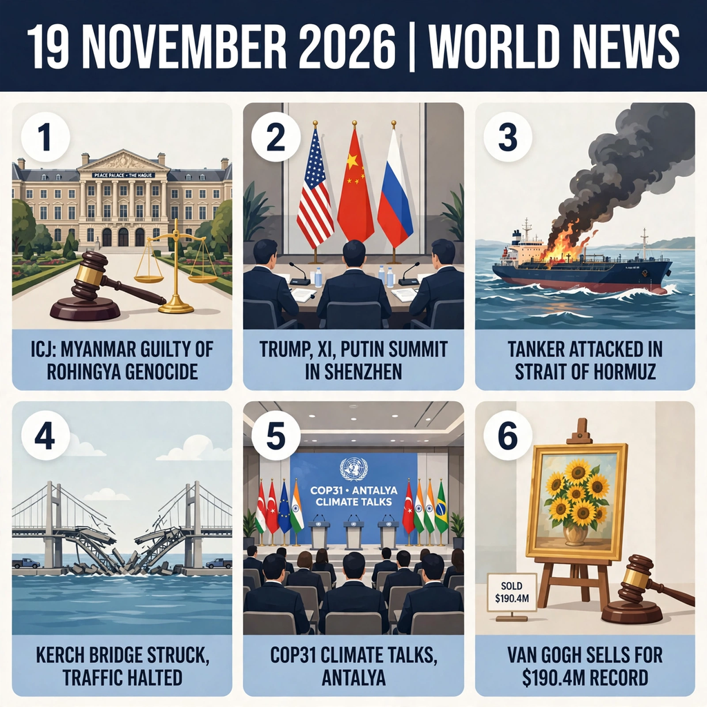

# 19 November 2026 in one image

[](https://make.fun/bounty/news-image-20261119?utm_source=github&utm_medium=readme&utm_campaign=news-image-20261119)
[](https://make.fun/bounty/news-image-20261119/leaderboard?utm_source=github&utm_medium=readme&utm_campaign=news-image-20261119)
[](https://make.fun/bounty/news-image-20261119?utm_source=github&utm_medium=readme&utm_campaign=news-image-20261119)

A [make.fun](https://make.fun) `news-image-20261119` entry: one image that sums up
the world news of Thursday 19 November 2026. Built for make.fun — referral code `svtazsn5`.



## What the image shows

Six panels, one day:

1. **The Hague** — the International Court of Justice ruled that Myanmar
   committed genocide against the Rohingya in 2017, a 9–6 verdict in the
   case brought by Gambia.
2. **Shenzhen** — Trump, Xi and Putin held the first-ever trilateral summit
   of the three largest nuclear powers, ending in a joint four-point
   "Declaration toward Peace".
3. **Strait of Hormuz** — tanker attacks escalated as US–Iran strikes
   continued; an ADNOC vessel was hit, leaving 11 crew injured and one
   missing, and Iran said mines disabled three tankers.
4. **Kerch Bridge** — Ukrainian strikes wrecked the Crimean Bridge for a
   fourth day, halting road traffic to Crimea.
5. **COP31, Antalya** — ministers met in informal session to unblock climate
   negotiations in the talks' decisive phase, ahead of the scheduled
   20 November close.
6. **Art market** — a Van Gogh painting sold for $190.4 million, a record
   for the artist.

The image is an original AI-generated editorial collage (1024x1024, under
1 MiB). It names the day it sums up in its banner.

## How it works

`main.py` (Python 3.13, standard library only) copies `entry.png` to
`/output/entry.png`. No network, no randomness: two runs write the same bytes.

```sh
mkdir -p out && MAKEFUN_OUTPUT_DIR=out python3 main.py
```

## License

MIT — see `LICENSE`.
